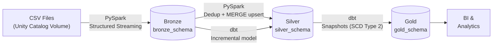
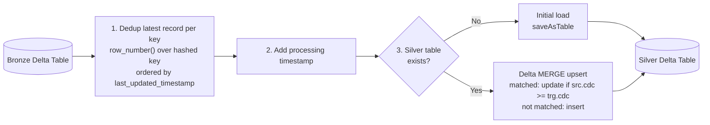
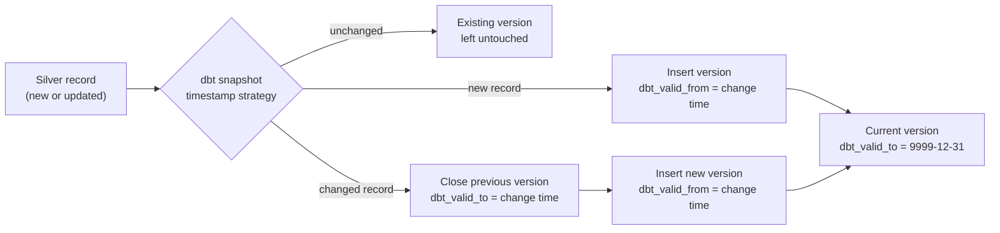
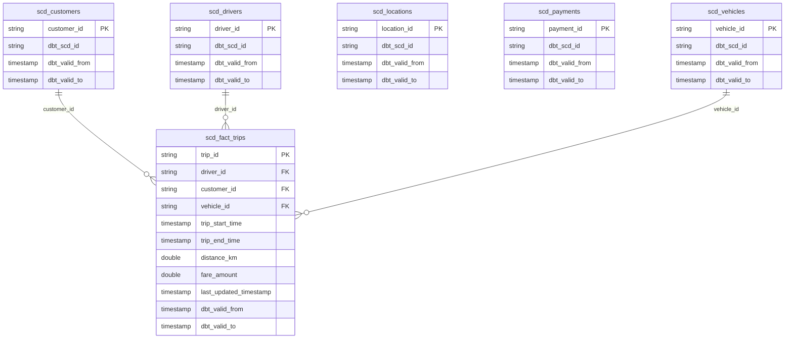
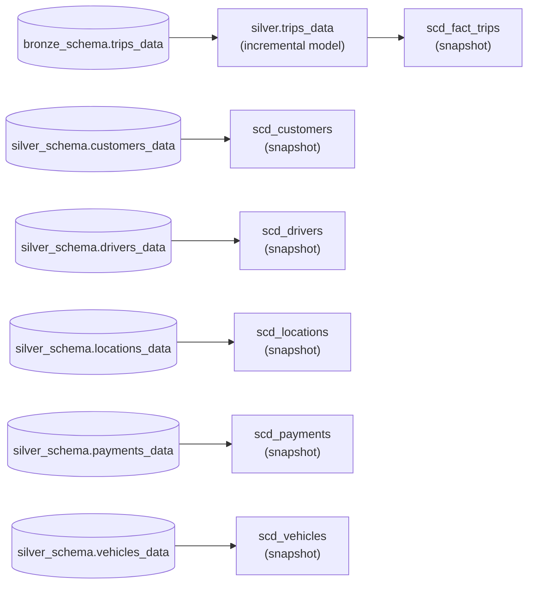

# Databricks PySpark dbt Project


> An end-to-end data engineering pipeline built on **Databricks** that ingests raw CSVs with **PySpark Structured Streaming**, transforms them through a **Medallion (Bronze → Silver → Gold) architecture** using **PySpark** and **dbt**, and delivers a **star schema** with **SCD Type 2** historical tracking.

## Table of Contents

- [Overview](#overview)
- [Architecture](#architecture)
- [Data Flow](#data-flow)
- [Data Model](#data-model)
- [dbt Lineage](#dbt-lineage)
- [Tech Stack](#tech-stack)
- [Project Structure](#project-structure)
- [Repository Components](#repository-components)
- [Key Engineering Patterns](#key-engineering-patterns)
- [Getting Started](#getting-started)
- [dbt Commands](#dbt-commands)

---

## Overview

This project implements a production-style pipeline for a rideshare-style domain (trips, customers, drivers, vehicles, locations, payments). Six CSV entities land in a Unity Catalog Volume and flow through three curated layers:

- **Bronze** — raw ingestion from source files into Delta tables using PySpark Structured Streaming with checkpointed, restartable loads.
- **Silver** — deduplicated, conformed and upserted entity tables that always reflect the latest state of each entity. Dimension entities are processed by a reusable PySpark transformation class; trips are modeled with an incremental dbt model.
- **Gold** — business-ready **SCD Type 2** dimensions and a fact table with full history, generated entirely by dbt snapshots.

### Highlights

- Streaming ingestion with per-entity `checkpointLocation`s for reliable incremental loads
- Idempotent Delta `MERGE` upserts guarded by a CDC watermark (`last_updated_timestamp`)
- Dynamic, entity-driven pipelines — one parameterized loop instead of six copy-pasted jobs
- Historical tracking via SCD Type 2 (`dbt_valid_from` / `dbt_valid_to`)
- Version-controlled, CI/CD-ready dbt Cloud deployment

---

## Architecture



| Layer | Schema | Built with | Responsibility |
|-------|--------|------------|----------------|
| 🥉 Bronze | `bronze_schema` | Databricks notebook + PySpark Structured Streaming | Raw ingestion of source CSVs into Delta tables with checkpointed incremental loads |
| 🥈 Silver | `silver_schema` | Databricks notebook (PySpark) + dbt model | Deduplicated and conformed entity tables that always hold the latest state |
| 🥇 Gold | `gold_schema` | dbt snapshots | SCD Type 2 dimensions and fact history for analytics and reporting |

### Entities

| Entity | Bronze | Silver | Gold (SCD Type 2) |
|--------|:------:|:------:|:-----------------:|
| `customers_data` | ✅ | ✅ upsert | `scd_customers` |
| `drivers_data` | ✅ | ✅ upsert | `scd_drivers` |
| `locations_data` | ✅ | ✅ upsert | `scd_locations` |
| `payments_data` | ✅ | ✅ upsert | `scd_payments` |
| `vehicles_data` | ✅ | ✅ upsert | `scd_vehicles` |
| `trips_data` | ✅ | ✅ dbt incremental | `scd_fact_trips` |

---

## Data Flow

### Bronze — Streaming Ingestion

Each entity's CSV folder is read from the Unity Catalog Volume. The schema is inferred from a sample batch read, then a Structured Streaming job continuously writes new files into the corresponding bronze Delta table using `trigger(availableNow = True)` and a dedicated checkpoint location.

### Silver — Dedup, Timestamp & Upsert



### Gold — SCD Type 2 History



---

## Data Model

The Gold layer follows a **star schema**: one fact table (`scd_fact_trips`, one row per trip) surrounded by conformed SCD Type 2 dimensions.



- Dimension attributes are inherited from the conformed silver tables and versioned by dbt snapshots.
- `scd_locations` and `scd_payments` enrich the model with geographic and payment history and are maintained with the same SCD Type 2 pattern.
- Every snapshot carries audit columns (`dbt_scd_id`, `dbt_updated_at`, `dbt_valid_from`, `dbt_valid_to`); the current version of each record is marked with `dbt_valid_to = 9999-12-31` via `dbt_valid_to_current`.

---

## dbt Lineage



---

## Tech Stack

| Layer / Concern | Technology | Role |
|-----------------|------------|------|
| Ingestion | PySpark Structured Streaming (Databricks) | Incremental CSV → Delta ingestion with checkpoints |
| Storage | Delta Lake + Unity Catalog | ACID tables across `bronze_schema`, `silver_schema`, `gold_schema` |
| Transformation (Python) | PySpark | Deduplication, timestamping, Delta `MERGE` upserts |
| Transformation (SQL) | dbt Cloud (Jinja, sources, macros) | Incremental models and dynamic SQL generation |
| Historical Tracking | dbt snapshots | SCD Type 2 for dimensions and fact |
| Development & Deployment | Databricks notebooks, dbt Cloud (Git, CI/CD) | Development, version control, managed runs |
| Languages | Python 3 · SQL · YAML · Jinja | |

---

## Project Structure

```
databricks_pyspark_dbt_project_01/
├── analyses/
│   └── demo.sql                  # Ad-hoc query against the bronze source
├── macros/
│   └── generate_schema_name.sql  # Custom schema naming (uses custom schema as-is)
├── models/
│   ├── source_folder/
│   │   └── source_file.yml       # Source definitions (bronze + silver)
│   └── silver/
│       └── trips_data.sql        # Incremental trips model (Jinja-generated columns)
├── notebooks/
│   ├── bronze_layer.ipynb        # Streaming ingestion: Volume → bronze_schema
│   └── silver_layer.ipynb        # Dedup + MERGE upserts → silver_schema
├── seeds/                        # (dbt scaffold, currently empty)
├── snapshots/
│   ├── scd.yml                   # SCD Type 2 snapshots for dimension tables
│   └── fact_scd.yml              # SCD Type 2 snapshot for the fact table
├── tests/                        # (dbt scaffold, currently empty)
├── utlis/
│   └── custom_utlis.py           # Reusable PySpark transformation class
├── dbt_project.yml               # dbt project configuration & materializations
└── README.md
```

---

## Repository Components

### Bronze Layer — `notebooks/bronze_layer.ipynb`

- Infers each entity's schema from a sample batch read of its CSV folder in the Unity Catalog Volume.
- Starts a Structured Streaming job per entity that writes new files into `bronze_schema` Delta tables.
- Uses `trigger(availableNow = True)` and per-entity checkpoint locations, so runs process only newly arrived files and are restartable.
- Iterates over a single entity list — `customers_data`, `drivers_data`, `locations_data`, `payments_data`, `trips_data`, `vehicles_data` — instead of duplicating ingestion logic.

### Silver Layer — `notebooks/silver_layer.ipynb`

- Reads each bronze entity, then applies the shared `transformations` class:
  - `dedup()` — keeps the most recent record per business key using `row_number()` ordered by `last_updated_timestamp` descending.
  - `processing_timestamp()` — stamps each record with `process_timestamp`.
  - `upsert()` — on first run creates the table (`saveAsTable`); afterwards performs an idempotent Delta `MERGE` (`whenMatchedUpdateAll` guarded by the CDC watermark, `whenNotMatchedInsertAll`).
- Imports the utility class directly from this repository (Databricks Repos), keeping transformation logic DRY and reusable.

### dbt Transformations — `models/`

- `source_folder/source_file.yml` — declares the `bronze_source` (trips) and `silver_source` (five dimension entities) sources, enabling `source()`-based lineage and testing.
- `silver/trips_data.sql` — **incremental** model (`unique_key = trip_id`) that moves trips from bronze to silver. A Jinja `for` loop renders the projection from a Python column list, and an `is_incremental()` filter loads only records newer than the target's max `last_updated_timestamp`.

### dbt Snapshots — `snapshots/`

- `scd.yml` — SCD Type 2 snapshots for `customers`, `drivers`, `locations`, `payments` and `vehicles`, all using the `timestamp` strategy on `last_updated_timestamp`.
- `fact_scd.yml` — the same SCD Type 2 pattern applied to the trips fact via `ref('trips_data')`.
- All snapshots land in `gold_schema` and keep current rows open-ended with `dbt_valid_to_current = to_date(9999-12-31)`.

### Macros & Analyses

- `macros/generate_schema_name.sql` — overrides dbt's default schema naming so custom schemas (`silver_schema`, `gold_schema`) are used exactly as configured, without the target-schema prefix.
- `analyses/demo.sql` — a compiled-but-not-materialized sample query against the bronze trips source.

---

## Key Engineering Patterns

- **Medallion Architecture** — Bronze, Silver and Gold layers implemented as separate Unity Catalog schemas with clear separation of concerns.
- **Dimensional Data Modeling** — a star schema with a trip-grain fact table joined to conformed dimensions on their business keys.
- **Slowly Changing Dimensions (Type 2)** — every dimension and the fact table retain full history via dbt snapshots instead of being overwritten.
- **Spark Structured Streaming** — incremental, checkpointed ingestion from Unity Catalog Volumes into Delta Lake.
- **Incremental Processing & Upserts** — Delta `MERGE` logic updates existing rows only when the incoming change timestamp is newer, making pipelines idempotent.
- **Deduplication** — window functions pick the latest version of each record before it is merged.
- **Dynamic, Scalable Code** — Python classes, loops and modular utilities mean adding a new entity requires configuration, not new pipeline code.
- **Advanced dbt** — sources, Jinja-generated SQL, incremental materialization, ephemeral-ready model configuration, custom macros and automated snapshots.
- **CI/CD with dbt Cloud** — Git-based version control, dbt Cloud CLI for local development, and managed jobs for scheduled deployments.

---

## Getting Started

### Prerequisites

- A Databricks workspace with Unity Catalog enabled and a cluster that can run PySpark
- A dbt Cloud account connected to Databricks (profile: `default`), or dbt Core with the `dbt-databricks` adapter
- Access to this Git repository (checkout it in Databricks Repos to run the notebooks)

### Unity Catalog Setup

```sql
CREATE CATALOG IF NOT EXISTS databricks_pyspark_dbt_project_01;

CREATE SCHEMA IF NOT EXISTS databricks_pyspark_dbt_project_01.bronze_schema;
CREATE SCHEMA IF NOT EXISTS databricks_pyspark_dbt_project_01.silver_schema;
CREATE SCHEMA IF NOT EXISTS databricks_pyspark_dbt_project_01.gold_schema;

-- Volume for raw source files
CREATE SCHEMA IF NOT EXISTS databricks_pyspark_dbt_project_01.source_files;
CREATE VOLUME IF NOT EXISTS databricks_pyspark_dbt_project_01.source_files.source_files;

-- Volume for streaming checkpoints
CREATE VOLUME IF NOT EXISTS databricks_pyspark_dbt_project_01.bronze_schema.checkpoint_locations;
```

Then upload each entity's CSV files into its own folder:

```
/Volumes/databricks_pyspark_dbt_project_01/source_files/source_files/<entity>/
```

where `<entity>` is one of `customers_data`, `drivers_data`, `locations_data`, `payments_data`, `trips_data`, `vehicles_data`.

### Run the Pipeline

1. **Ingest to Bronze** — run `notebooks/bronze_layer.ipynb` on a Databricks cluster. All six entities are streamed into `bronze_schema`.
2. **Transform to Silver** — run `notebooks/silver_layer.ipynb` to dedup and upsert the dimension entities into `silver_schema`.
3. **Build dbt models** — `dbt run` to build the `trips_data` incremental model into `silver_schema`.
4. **Capture history** — `dbt snapshot` to execute the SCD Type 2 snapshots into `gold_schema`.
5. **Validate** — `dbt test` to run data quality tests across models and sources.

---

## dbt Commands

| Command | Description |
|---------|-------------|
| `dbt debug` | Validate the Databricks connection and profile |
| `dbt run` | Build the `trips_data` incremental model |
| `dbt snapshot` | Execute SCD Type 2 snapshots into `gold_schema` |
| `dbt test` | Run data quality tests on models and sources |
| `dbt build` | Run models, tests and snapshots in dependency order in a single job |
